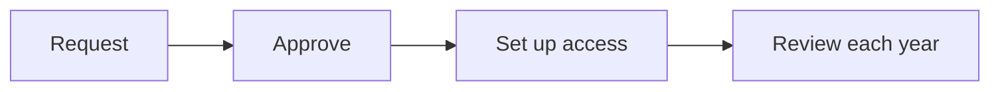

# Content files

The files in `content/guides/` are the guides, one file each. The files in `content/controls/` are the controls and risks, one YAML file per topic (see `content/controls/README.md`). The files in `content/engine/` are copies of the risk engine's files, and `content/drivers/drivers.json` holds TRAC's own details for each driver (see "Risk engine files and drivers.json" below). The files in `content/platforms/` are the platform list and the guidance for each category and platform (see "Platform and category files" below). You can open them in any editor and read them like a document. They are the place to update this content over time.

## How an update gets into the site

1. Edit the file.
2. Check it: `.\trac.ps1 check` (or `python manage.py check_content`).
3. Send it to the site: `.\trac.ps1 sync -Publish` (or `python manage.py sync_content --user your-username --publish`).

While single-approver mode is on (`ALLOW_SELF_APPROVAL`), `--publish` approves and publishes the update, and the page changes. Without it, the update waits in the site as a draft for a second Tech Risk person to approve. Add `-DryRun` (`--dry-run`) to see what would happen without changing anything.

The sync is careful. For each guide, control, risk or piece of guidance (matched by title, or by category or platform) it does exactly one of these:

- **New**: not on the site yet, so it becomes a draft.
- **Unchanged**: the file has not changed since the last sync, so it is left alone.
- **In progress**: a change is already open in the site, so it is skipped until that change is finished or discarded.
- **Edited in the site**: someone changed it in the site since the last sync, so it is skipped and their edit is not lost. Run `.\trac.ps1 export` to bring the site's text into the file (then carry on editing the file), or add `--force` to replace the site's version with the file.
- **Update**: the file changed, so a new draft version is proposed.

A retired item is left alone. The rules live in one place, `apps/core/content_sync.py`.

## If you edited in the site

`.\trac.ps1 export` (`export_content`) writes the current published text of every guide, control, risk and piece of category or platform guidance back to its file, so the files and the site match again. For one guide use `python manage.py export_guides --title "Guide title"`; for one topic, `export_controls --topic "Change management"`.

## The top of every file

Each file starts with a short header between two lines of three dashes:

```
---
title: Initiative lifecycle
section: build
platform: GitHub Enterprise Server
order: 8
---
```

| Line | Needed? | What it does |
|---|---|---|
| `title` | yes | The guide's name. If a guide with this title already exists, the file is skipped. |
| `section` | yes | Where it appears: `build`, `run`, `best_practice` or `audit_prep`. |
| `platform` | no | Tags the guide to a platform, using the platform's name exactly as it appears in the site. An unknown name gives a warning and the guide loads without a platform. |
| `order` | no | Controls the order guides are loaded in (lowest first). |

The file name is the web address of the guide, for example `initiative-lifecycle.md` becomes `/guides/initiative-lifecycle/`. Use lowercase words joined by dashes.

## How headings become cards and links

- **Heading 2** (`## Name`) makes a card on the page and an entry in "On this page". Text before the first Heading 2 is the introduction.
- Every heading also gets a link address made from its words. If you rename a heading, its link changes.
- In the Initiative lifecycle guide, `## Stage 2: Build and configure` and `#### Item 3: ...` under it make the links the initiative tracker uses (for example `stage-2-item-3`). **Do not renumber** stages or items. Add new items at the end of a stage.
- End every guide with the line `If you're unsure, Tech Risk can help.` It must appear exactly once.

## Diagrams

A guide can hold a small diagram, written as plain text between two lines of three backticks. The site draws it in the site's colors. The text around it still explains the same thing, so the diagram is a help, not the only place a point is made.

````

````

Rules:

- The first line says the kind of diagram: `flowchart LR` (left to right), `flowchart TD` (top to bottom), `sequenceDiagram` or `stateDiagram-v2`.
- Always add `accTitle:` (a short title) and `accDescr:` (one sentence saying what the diagram shows). Screen readers read them. `check_guides` fails without them.
- Keep labels short and use sentence case. Put a label in square brackets, `A[Like this]`; an arrow is `-->`.
- One idea per diagram, about 5 to 12 boxes. Split a bigger picture into two.
- Place it right after the introduction, or at the top of the section it explains.

## Markdown cheat sheet

```
## Heading 2 (a card)
#### Heading 4 (a smaller heading)

A paragraph of text. **Bold text.** A [link to a guide](/guides/oversight-levels/).

- A bullet
- Another bullet

> A quoted line

| Column one | Column two |
|---|---|
| Cell | Cell |
```

Leave a blank line between paragraphs, and before and after a list or a table. A table cell cannot hold a list; the Initiative lifecycle guide uses a small block of HTML for that, marked with a note above it.

## Platform and category files

`content/platforms/` holds the platform list and the guidance shown on the Library's category pages.

```
content/platforms/catalog.yaml                  the list of platforms and the risk-area questions
content/platforms/categories/<category>.yaml    common practices for a category, for example database.yaml
content/platforms/<platform>.yaml               only what is different for one platform, for example sql-server.yaml
```

**How the pages layer.** A category file holds the common practices: what good looks like for any database, any identity service and so on. A platform file holds only what differs on that platform, so do not repeat the category text. On a category page the common practices always show; a reader switches on a platform's pill (for example AWS on the Cloud page) to add that platform's lines under the matching rows, marked "On AWS". A platform's lines appear on every category page it belongs to. The `runs_on` line in the catalog links platforms together: SQL Server runs on Windows Server, and its notes box links there.

**A category file** (the file is named after the category key: `application`, `database`, `operating_system`, `jobs`, `network`, `identity`, `cloud`, `engineering_tools`, `logging`):

```yaml
category: database
intro: >
  One or two sentences.
practices:            # any heading may be left out
  Access: |
    - point one
    - point two
  Change: |
    - ...
references:           # optional
  - label: Text
    link: https://...
```

**A platform file** (the file is named after the platform, in lowercase with dashes, for example `github-enterprise-server.yaml`):

```yaml
platform: Kubernetes      # the name exactly as in catalog.yaml
intro: >                  # optional
  ...
considerations:           # only what differs from the category practices
  Access: |
    - ...
references: []
```

- The headings under `practices` and `considerations` are the risk-area labels: Access, Service accounts, Change, Configuration, Logging, Patching, Recovery, Data, Network, Vendor. Capital letters do not matter. A heading that is not one of them is reported with the file name.
- Lines that start with `- ` (a dash and a space) show as a bullet list on the site. Anything else shows as plain text. No formatting or HTML is read from these files.
- Only the intro and the risk-area texts are compared when deciding whether a file changed. Spacing and line wrapping do not count.
- The platform must already exist, so the catalog is loaded first (`seed_platforms`, run by `setup_trac`). A platform name that is not in the site is reported with the file name.

**The catalog** (`catalog.yaml`) has a commented example at the top. It lists each platform (name, categories, hosting, `runs_on`, documentation link) and each risk-area question (topic prefix, label, question). `seed_platforms` only adds platforms and questions the site does not have; it never deletes and never overwrites, so once a site is live change existing platforms and questions in the site (Manage), and use the file for new ones.

The commands are `check_platforms`, `sync_platforms` and `export_platforms`; `check_content`, `sync_content` and `export_content` run them after the guides and controls. They work like the others, including `--dry-run`, `--force` and `--publish`. A site edit to guidance (Edit guidance on a category page, or in a platform's box) is brought back into the files by `export_platforms`.

## Risk engine files and drivers.json

The risk engine is the master list of risk drivers (RD01 to RD67) and of its own risks. Its files are copied into TRAC and are read-only here:

```
content/engine/driver_mapping.yaml     every driver: trigger, questionnaire_fields, rationale
content/engine/risks/*.yaml            the engine's risks, one file per risk category
content/drivers/drivers.json           TRAC's own details for each driver (the one file you edit)
```

The files that ship are samples (the first line of each YAML file says so). To refresh them from the engine, see `content/engine/README.md`; the commands are `check_engine` and `sync_engine`, and `check_content` and `sync_content` run them before the controls.

**What the sync does.** Each engine driver becomes a TRAC driver whose id is the engine's id (RD01). It has versions, approvals and history, and follows the same five outcomes as the other files (new, unchanged, in progress, edited in the site, update). Drivers are not created or edited in the site, so there is no export: change the engine files or drivers.json and sync again. The engine's risks are replaced by the new copy each time; they are not drafted or approved because the engine owns them. The pages that show them are Risks and controls → Engine risks and each driver's page.

**drivers.json.** One entry per driver, keyed by id, with the same five keys every time (empty is fine):

```json
{
  "RD01": {
    "title": "Systems with their own user accounts",
    "category": "Technology",
    "owner_role": "Head of Infrastructure",
    "indicators": [
      {"type": "leading", "text": "Number of systems that keep their own user lists."},
      {"type": "lagging", "text": "Leavers whose access was removed late."}
    ],
    "trac_risks": ["R-MA-03"]
  }
}
```

| Key | What it does |
|---|---|
| `title` | The driver's name on the site. Empty shows the id (RD01). |
| `category` | An optional group, such as People or Technology. |
| `owner_role` | The role accountable for the driver. Empty shows "Not assigned yet". |
| `indicators` | How you would know the driver is present or growing. Each has a `type` of `leading` or `lagging`, and `text`. |
| `trac_risks` | Ids of TRAC risks (such as R-MA-03) that this driver raises. They show on the driver page, on the risk page ("What raises it") and in the explorer's Drivers column. The risk's own driver choice on its edit form works too. |

`sync_engine` adds an empty entry for every engine driver the file lacks, and never deletes an entry. An entry for a driver that is no longer in the engine is kept and ignored (a warning says so). `check_engine` reports a mistake with the file name and the driver, for example an indicator type that is not leading or lagging.

**Rules for the engine files.** Scoring rules are kept as text and shown as text; TRAC never runs them. Every RD id in a risk's driver lists, or inside a scoring rule, must be in `driver_mapping.yaml`. Framework mappings are stored but never shown. `framework mappings` with a space is accepted for `framework_mappings`; unknown keys give a warning, not an error. A risk file may hold one risk or a `risks:` list.

## Check your edit

```
.\trac.ps1 check
```

It reads every file and tells you in plain words about anything wrong. For guides: a missing header, an unknown section, a missing or repeated help line, or wording the team avoids (for example "standard", "reach out", "route"). The wording check also covers the controls and platform files.

A vendor's own name for a product, setting or tier always wins over that list (for example Databricks' "standard access mode"). To allow a vendor's term, add it to `PRODUCT_TERMS` in `apps/wiki/guide_checks.py`. It stops with an error if there are problems.
