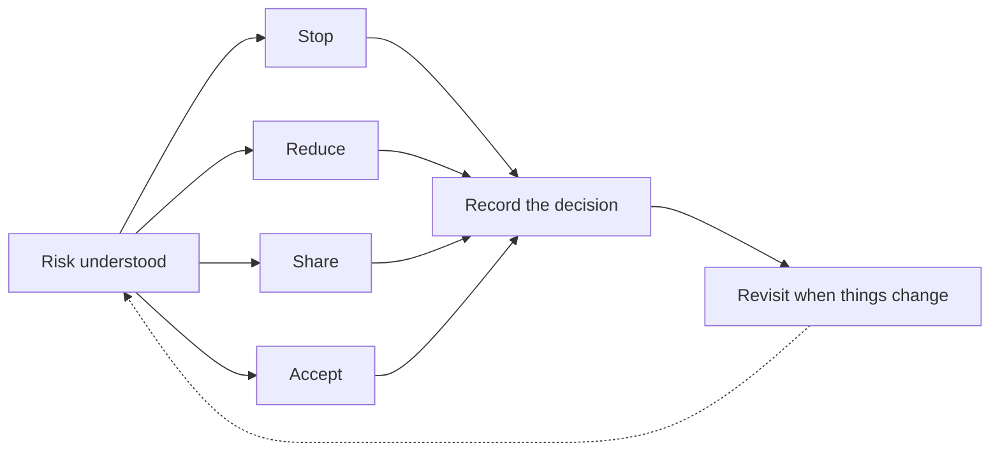

Once a risk is understood, there are four ways to respond to it. Most teams reach for a control first, and often that is right, but it helps to consider all four and record why you chose the one you did.

## The four responses

- **Stop.** Stop the activity or remove the condition that creates the risk. For example, retire an unused interface instead of securing it, or decline a design that can't be controlled.
- **Reduce.** Lower the chance or the impact with controls. This is where most of TRAC's guidance applies: design a control that prevents or detects the problem, and keep evidence that it runs.
- **Share.** Pass part of the risk to someone better placed to handle it, such as a vendor or an insurer. The firm still owns the outcome, so check what the vendor does and review their assurance.
- **Accept.** Decide, knowingly, to live with the risk for now. The business or system owner makes that decision and it is recorded. See [When an exception is appropriate](/guides/when-an-exception-is-appropriate/).

## How to choose

- Start with how serious the risk is: what could happen, to which systems or data, and how bad the result would be. A tier 0 or tier 1 system or a SOX in-scope system calls for a stronger response.
- Compare the effort of each response with the reduction in risk it buys. A control that costs more than the harm it prevents is a poor choice.
- Combine responses where it helps. For example, share a risk with a vendor and keep a control that checks their work.
- Check the result against the firm's tolerances, such as the recommended timelines by BCP tier and the initiative oversight levels.

## Writing the risk down the same way every time

A clear risk statement makes the right response easier to see. Use the same three parts each time:

- **What could happen, and to what:** the event and the systems or data it affects.
- **Why it could happen:** the weakness or condition that allows it.
- **What the result would be:** the impact on the business, customers, financial reporting or security.

For example: "A person who has left keeps access to a production database. This can happen when access removal isn't triggered by HR events. The result could be data viewed or changed without authority."

## Recording the decision

- Record which response you chose, why, and who decided.
- Link the risk to the controls that reduce it, so the coverage is visible.
- Revisit the decision when the system, the threat or the business changes, and at least when the system's controls are reviewed.

If you're unsure, Tech Risk can help.
