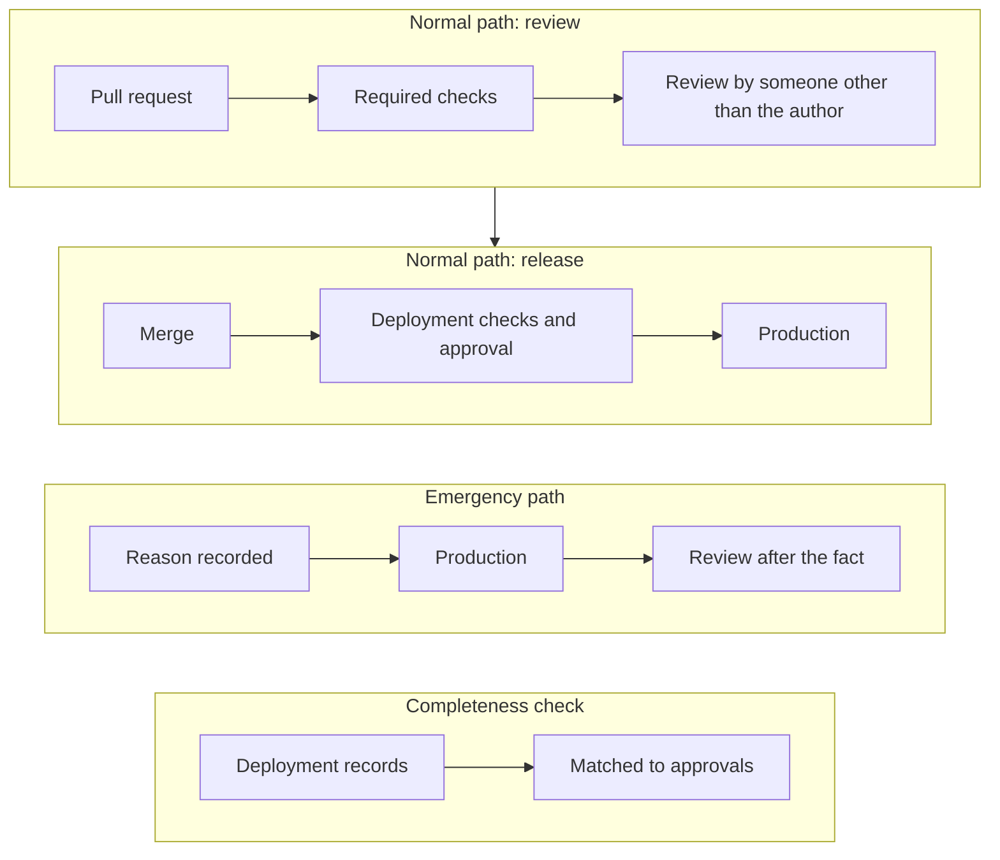

A well-built continuous integration and continuous delivery (CI/CD) pipeline can be your change control. When every change reaches production through a reviewed pull request and an automated deployment, the pipeline's own records show who changed what, who approved it and when it went live. This guide describes what good looks like and the records that prove it. GitHub Enterprise Server and Databricks are used as examples.

## What should the pipeline be able to show?

A reviewer checking change management will ask four questions. A good pipeline answers each from its own records.

- **Was every change requested and approved?** Each production change traces to a request and an approved pull request.
- **Was the approver the right person?** The approval record names someone other than the author who has the knowledge and seniority to judge the change, such as a tech lead or the code owner for that area. Higher-risk changes call for a more senior approver.
- **Could anyone change production another way?** Nobody has standing access that skips the pipeline for day-to-day work, and any exception is logged and reviewed.
- **Is the list of changes complete?** A system-generated list of every production deployment in a period can be matched to approvals.

## How do you make sure every change is reviewed?

The pull request is the change approval, so the repository is set up so it can't be skipped: a pull request, an appropriate approver other than the author, passing checks and no bypass on the default and release branches. The details are in [Repository management](/guides/repository-management/).

- The same path covers application code, configuration, infrastructure as code, database schema and job definitions, and each pull request carries its request number.

## How do you keep production changes inside the pipeline?

Review means little if someone can change production directly.

- The pipeline deploys with its own service identity. People don't hold standing write access to production for day-to-day work, and can't reuse the pipeline's credentials. Administrators who need write access for platform support are named, use separate admin accounts, and are covered by the privileged access review.
- Schema changes are migration scripts and infrastructure is applied from code, both through the pipeline.
- A direct change that can't be avoided is recorded with a reason and approval, then reviewed by someone other than the person who made it.

## How do you protect the pipeline itself?

Anyone who can edit the pipeline can edit the controls out of it, so pipeline definitions are best treated as production code.

- Named owners approve every change to pipeline files (see [Repository management](/guides/repository-management/)).
- A small, named group manages deployment environments and secrets, and changes to those settings are logged and reviewed. Workflow and runner security is in [GitHub Actions runners](/guides/github-actions-runners/).
- The production deployment step has its own gates: required checks that can't be skipped, and a named approver other than the author, at a seniority that fits the risk of the release. A way back is known before each release.

## What about emergencies and proving completeness?

Some fixes can't wait for the normal path.

- The team knows what counts as an emergency and who may use the path. Each use records a reason.
- Every emergency change is reviewed after the fact, within the time set in your procedure. A steady stream of emergencies is a sign the normal path needs fixing.
- On the schedule set in your procedure, the deployment history is matched to approvals. It comes from the system, not a hand-kept spreadsheet, and anything unmatched is followed up.

## How does this work on GitHub Enterprise Server and Databricks?

- **GitHub Enterprise Server:** the pull request, environment and deployment history are the evidence, and the audit log is streamed to Splunk. See the Engineering tools page in the Library, with GitHub Enterprise Server switched on, and the two guides linked above.
- **Databricks:** notebooks, jobs and pipelines are kept in Git and deployed with Declarative Automation Bundles (formerly Databricks Asset Bundles), run by the pipeline as a service principal. People don't have edit rights in the production workspace, and workspace audit logs show production changes came from the deployment identity.

If you're unsure, Tech Risk can help.
