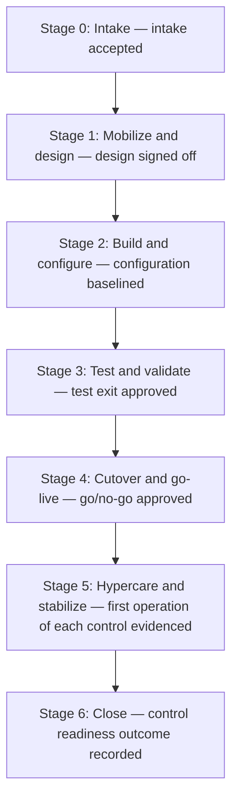

How to manage risk and controls through each stage of a major initiative, from intake to close. Each stage lists its exit gate, who approves it, the controls to consider, the evidence to keep and the question an auditor will ask. The checklist for each initiative is kept in the initiative tracker; for each checklist item, this guide says what good evidence looks like.

How much sign-off each stage needs depends on the initiative's [oversight level](/guides/oversight-levels/).

## Guiding principles

These apply at every stage. The stages below set out what each one means in practice.

- Every confirmation records its basis (artifact reviewed, independently observed or tested, or owner attestation only) and where the evidence is kept. Auditors can see which confirmations rest on attestation alone.
- Whoever builds or configures a control does not review its testing or its first operation.
- Control coverage has no gaps. The old system's controls keep running, with evidence, until cutover, and that evidence is kept after the old system is retired. Any period a control can't operate is covered by an interim control with an agreed end condition.
- Each stage exit is recorded at the time, with the date and where the evidence is kept, not pieced together afterwards.
- Evidence stays in its system of record. The initiative tracker holds the reference and the date it was confirmed.

## Stages at a glance

## Stage 0: Intake

**Exit gate:** Intake accepted; baseline go-live date fixed; initiative added to the book of work.

<!-- This table is written in HTML because each cell holds a bullet list, which a Markdown table cannot do. Edit only the text inside the <li> items. -->
<table>
<thead><tr><th>Controls to consider</th><th>Evidence to keep</th></tr></thead>
<tbody>
<tr><td><ul><li>Scoping: in-scope systems, reports and controls touched</li></ul></td><td><ul><li>Intake form (versioned)</li><li>Acceptance record</li><li>Baseline go-live date</li></ul></td></tr>
</tbody>
</table>

**What good evidence looks like**

#### Item 1: Intake accepted

A record of who accepted the initiative and when, pointing to the version of the intake form that was accepted.

#### Item 2: Baseline go-live recorded

The go-live date agreed at intake and the date it was set. Later changes are added as new dates, not written over the first.

#### Item 3: Affected systems and controls listed

A dated list of every system, report and control the initiative touches, with where the list came from, such as a control library extract.

> **The auditor will ask:** “How did you decide this was in scope for risk oversight, and when?”

## Stage 1: Mobilize and design

**Exit gate:** Solution design signed off; control impact assessment complete; every affected control has an impact type.

**How:** For a complete control impact assessment, start from the control library filtered to the systems named at intake, then confirm the list with each control owner. Record who was consulted.

<!-- This table is written in HTML because each cell holds a bullet list, which a Markdown table cannot do. Edit only the text inside the <li> items. -->
<table>
<thead><tr><th>Controls to consider</th><th>Evidence to keep</th></tr></thead>
<tbody>
<tr><td><ul><li>Control design for new and changed controls</li><li>Segregation of duties model</li><li>Data migration approach (completeness and accuracy)</li><li>Interfaces</li><li>Reports used in controls</li><li>Compensating and interim controls</li></ul></td><td><ul><li>Design sign-off</li><li>Control impact assessment</li><li>Risk assessment</li><li>Segregation of duties matrix</li><li>Migration strategy</li><li>Vendor SOC report review (if applicable)</li></ul></td></tr>
</tbody>
</table>

**What good evidence looks like**

#### Item 1: Design signed off

The sponsor's name, the date and the version of the design they approved. An email is acceptable if it names the document version.

#### Item 2: Control impact assessment complete

Each affected control with its impact type (new, changed, retired or unaffected), the control library extract it started from, and who confirmed it and when.

#### Item 3: Segregation of duties model agreed

The roles and the duties that conflict, who agreed the model and when, and how any conflict that can't be removed is covered.

#### Item 4: Migration approach documented

What data moves, how completeness and accuracy will be shown (counts, balances, samples), and who signs off the reconciliation. If reports used in key controls move or change, see [Reports used in controls](/guides/can-you-trust-the-report/).

#### Item 5: Interim and compensating controls agreed

For each one: the owner, what it covers, how it will be evidenced and its end condition, either a date or an event.

> **The auditor will ask:** “Show me you identified control impact before build, not after.”

## Stage 2: Build and configure

**Exit gate:** Build complete in non-production; configuration baselined.

<!-- This table is written in HTML because each cell holds a bullet list, which a Markdown table cannot do. Edit only the text inside the <li> items. -->
<table>
<thead><tr><th>Controls to consider</th><th>Evidence to keep</th></tr></thead>
<tbody>
<tr><td><ul><li>Change management on project environments</li><li>Developer access compared with production access</li><li>Configuration documentation</li><li>Security baseline</li></ul></td><td><ul><li>Build and configuration baseline</li><li>Access lists for project environments</li><li>Change log</li></ul></td></tr>
</tbody>
</table>

**What good evidence looks like**

#### Item 1: Configuration baselined

A dated export or snapshot of the configuration, kept where it can't be edited, so later changes can be compared against it.

#### Item 2: Project environment access list kept

A dated, system-generated list of who had access to each project environment and at what level.

#### Item 3: Development and production access kept apart

A comparison of build team access with production access showing nobody can both change the build and move it to production, or the review that covers anyone who can.

> **The auditor will ask:** “Who had access to what during build, and could they also move it to production?”

## Stage 3: Test and validate

**Exit gate:** Test exit approved; defects within tolerance; control testing complete; migration rehearsal reconciled.

**How:** The person who dry-runs a control must not have built or configured it. Record the tester's name and role. At least one dry run of each new control is observed by someone outside the program. Dry-run results show the design works; they aren't evidence that the control operated in production.

<!-- This table is written in HTML because each cell holds a bullet list, which a Markdown table cannot do. Edit only the text inside the <li> items. -->
<table>
<thead><tr><th>Controls to consider</th><th>Evidence to keep</th></tr></thead>
<tbody>
<tr><td><ul><li>Test strategy and traceability</li><li>UAT sign-off</li><li>Control dry run (does it operate as designed?)</li><li>Migration reconciliation (counts and balances)</li><li>Performance and disaster recovery testing</li></ul></td><td><ul><li>Test plans and results</li><li>Defect log with disposition</li><li>UAT sign-off</li><li>Migration reconciliation</li><li>Control walkthrough evidence</li></ul></td></tr>
</tbody>
</table>

**What good evidence looks like**

#### Item 1: UAT signed off

The business owner's name, the date, the test cycle covered and any open defects they accepted.

#### Item 2: New and changed controls dry-run independently

For each control: the dry-run result, the tester's name and role, and confirmation the tester didn't build or configure it.

#### Item 3: Control dry run observed

Notes from at least one observed dry run of each new control: who observed it, the date and what they saw.

#### Item 4: Migration rehearsal reconciled

Source and target counts and balances side by side, with every difference explained and signed off.

#### Item 5: Defects within tolerance

The defect log at test exit, with each open defect's severity, what was decided (fixed, accepted or deferred) and who accepted it.

> **The auditor will ask:** “Did you test the controls, not only the functionality? Did the migration reconcile?”

## Stage 4: Cutover and go-live

**Exit gate:** Go/no-go approved; production change approved; access provisioned as designed; rollback ready.

<!-- This table is written in HTML because each cell holds a bullet list, which a Markdown table cannot do. Edit only the text inside the <li> items. -->
<table>
<thead><tr><th>Controls to consider</th><th>Evidence to keep</th></tr></thead>
<tbody>
<tr><td><ul><li>Go/no-go checklist</li><li>Production change record</li><li>Access provisioning approvals</li><li>Final data reconciliation</li><li>Backup before cutover</li><li>Rollback plan</li></ul></td><td><ul><li>Go/no-go minutes</li><li>Change tickets</li><li>Access approvals</li><li>Final reconciliation</li><li>Backup confirmation</li><li>Rollback plan</li></ul></td></tr>
</tbody>
</table>

**What good evidence looks like**

#### Item 1: Go/no-go approved

Minutes or a decision record naming the chair, who attended, the decision and any conditions.

#### Item 2: Production change approved

The approved change ticket for the release, approved before the change window, with the approver and date.

#### Item 3: Access set up as designed

Production access as granted, compared with the approved access design, with any differences approved.

#### Item 4: Final reconciliation complete

Final counts and balances for the production load, with differences explained and signed off.

#### Item 5: Backup taken and rollback plan ready

A job log or report showing the pre-cutover backup completed and when, and the rollback plan with its trigger and owner.

> **The auditor will ask:** “Show me the approval to go live, and evidence that the migrated data was complete and accurate.”

## Stage 5: Hypercare and stabilize

**Exit gate:** First operation of each new or changed control evidenced; hypercare incidents closed; interim controls retired or extended.

**How:** Hypercare is the period of close support after go-live. First-operation evidence is reviewed independently, not self-certified by the program. Interim controls must show operation evidence for the whole window before they are retired. One run shows a control works, but testers need enough runs before year-end to rely on it, so a go-live late in the year may need the interim control kept running.

<!-- This table is written in HTML because each cell holds a bullet list, which a Markdown table cannot do. Edit only the text inside the <li> items. -->
<table>
<thead><tr><th>Controls to consider</th><th>Evidence to keep</th></tr></thead>
<tbody>
<tr><td><ul><li>First-run evidence for every new or changed control</li><li>Monitoring</li><li>Elevated access removed</li><li>Interim control exit</li></ul></td><td><ul><li>First control operation evidence</li><li>Hypercare incident log</li><li>Access removal evidence</li><li>Interim control closure</li></ul></td></tr>
</tbody>
</table>

**What good evidence looks like**

#### Item 1: Every new or changed control operated at least once

Evidence from the first real run of each control, reviewed by someone who didn't build it, with the reviewer's name and the date.

#### Item 2: Interim controls evidenced for the whole window

Operation evidence for every period the interim control was in place, with no gaps.

#### Item 3: Interim controls retired or extended

A record that each interim control ended when its end condition was met, or an approved extension with a new end date.

#### Item 4: Project and elevated access removed

A dated access listing taken after removal, compared with the project access list, showing the access is gone.

#### Item 5: Hypercare incidents closed

The hypercare incident log with every incident closed or handed over to business-as-usual owners.

> **The auditor will ask:** “Show that each new control operated at least once. Was project access removed?”

## Stage 6: Close

**Exit gate:** Control readiness outcome recorded; retired controls confirmed; evidence archived; handover to business-as-usual owners.

<!-- This table is written in HTML because each cell holds a bullet list, which a Markdown table cannot do. Edit only the text inside the <li> items. -->
<table>
<thead><tr><th>Controls to consider</th><th>Evidence to keep</th></tr></thead>
<tbody>
<tr><td><ul><li>Decommissioning (retention and access removal)</li><li>Control library updated</li><li>Business-as-usual ownership confirmed</li></ul></td><td><ul><li>Closure record (versioned)</li><li>Evidence archive reference</li><li>Updated control mapping</li><li>Decommission confirmation</li></ul></td></tr>
</tbody>
</table>

**What good evidence looks like**

#### Item 1: Control readiness outcome recorded

A dated, versioned closure record giving the outcome for each new and changed control.

#### Item 2: Retired controls confirmed

Each retired control marked as retired in the control library, with the date and who confirmed it.

#### Item 3: Evidence archive recorded

Where the evidence is kept, who has access to it, and confirmation that it is kept for the period in the firm's [records retention schedule](#todo-records-retention-schedule).

#### Item 4: Control owners confirmed

A named business-as-usual owner for each control who has accepted it, with the date.

> **The auditor will ask:** “Where is everything, and who owns these controls now?”

If you're unsure, Tech Risk can help.
