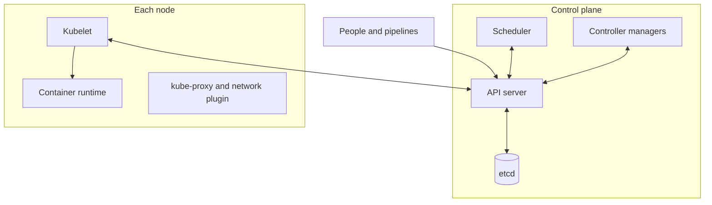

For each Kubernetes component, this guide covers what it does, what could go wrong, the controls that address it and how to show they work.

Kubernetes runs in many places. On a managed cluster, the cloud provider runs the control plane, and the system owner reviews the provider's SOC report (see [Reading a vendor's SOC report](/guides/reading-a-vendors-soc-report/)). The rest is shared between two groups, so this guide has two parts:

- **The platform team**, who run the clusters for everyone: API server access, etcd, the scheduler and controller managers, nodes and runtime, cluster-wide permissions, the network plugin, admission policies, add-ons and audit logging.
- **Teams that use Kubernetes**, who own their namespaces, workload settings, images, use of secrets, network policies for their workloads and their deployments.

## For the platform team

### API server access and cluster-wide permissions

**What it does:** the API server is the front door. Every request to read or change anything in the cluster goes through it, and cluster-wide permissions decide what each identity can do.

**What could go wrong:** someone reaches the API server without the right identity or with too much permission, and changes workloads or reads secrets. This can happen when the endpoint is open to the internet, sign-in isn't tied to named people, or permissions are too broad. The result could be outages, data exposure or unauthorized changes to production.

**Controls that address it:**
- The API endpoint isn't reachable from the internet. It is private, or limited to approved networks.
- People sign in through single sign-on, not shared kubeconfig files or personal certificates, and anonymous access is off.
- Cluster-wide permissions use role-based access control (RBAC), and nobody holds cluster-admin day to day.
- Rights that let someone raise their own access are reviewed as administrator rights.

**How to show it:** the endpoint access settings and the cluster-wide role bindings with their members. On a managed cluster, endpoint access, sign-in and permissions are still the platform team's.

### Control plane: etcd, scheduler and controller managers

**What they do:** etcd stores the state of everything in the cluster, including secrets. The scheduler and controller managers place workloads and keep the cluster matching what was asked for, including its link to the cloud provider. On a managed cluster, the provider runs these.

**What could go wrong:** someone reads or changes etcd directly, skipping every permission check, or uses the controllers' credentials to change the cluster or the cloud account. Or etcd data is lost. This can happen when etcd is reachable from other networks, isn't backed up, or controllers run with broad shared credentials. The result could be every secret exposed, wide control of the cluster or cloud account, or a cluster that can't be recovered.

**Controls that address it:**
- Only the API server can talk to etcd, and secrets and disks are encrypted.
- etcd is backed up with limited access, a restore has been tested, and access to the encryption key is part of the recovery plan.
- Each controller has its own identity, and the cloud controller manager has only the cloud permissions it needs.

**How to show it:** recent etcd backup results, the last restore test and the cloud role used by the cloud controller manager. On a managed cluster, the cloud permissions in your account still need showing.

### Nodes: kubelet and container runtime

**What they do:** nodes are the servers that run workloads. The kubelet on each node starts containers and reports to the API server, and the runtime (such as containerd) runs them.

**What could go wrong:** someone talks to the kubelet directly, or a node is compromised through an unpatched operating system or a container breaking out. This can happen when kubelet access isn't locked down or nodes are long-lived and patched by hand. The result could be every workload on that node, and its credentials, exposed.

**Controls that address it:**
- The kubelet checks every request and is reachable only from the control plane.
- Nodes use an approved image and are replaced rather than patched in place, on the schedule in the platform team's written procedure.
- Remote sign-in to nodes is off by default.

**How to show it:** the node image age for each node pool and patch or replacement records. On a managed cluster, check the provider's settings for your node pools rather than assuming.

### Cluster networking: kube-proxy and the network plugin

**What they do:** carry traffic between workloads, and in and out of the cluster.

**What could go wrong:** one compromised workload reaches every other workload, the node's cloud metadata service or the internet. This can happen when the network plugin doesn't enforce network policies or all traffic is allowed by default. The result could be an attacker moving from one weak workload to sensitive systems.

**Controls that address it:**
- The network plugin enforces network policies.
- Outbound traffic is limited to what workloads need, including access to the node's cloud metadata service.

**How to show it:** the network plugin settings, and a test showing that blocked traffic is refused.

### Admission policies

**What they do:** check every new or changed workload against cluster rules before it is allowed in.

**What could go wrong:** a workload runs with more privilege than it should, such as a privileged container. This can happen when no admission rules exist or they are easy to bypass. The result could be a container breaking out to the node.

**Controls that address it:**
- Admission rules check every new workload and block privileged containers.
- Changes to the rules go through change control.

**How to show it:** the admission rules in place, and a test showing that a privileged container is refused.

### Add-ons: DNS, ingress, dashboards and agents

**What they do:** extra components installed in the cluster, such as DNS, the ingress controller, monitoring agents and policy engines.

**What could go wrong:** an outdated or over-privileged add-on gives an easy way in. This can happen when add-ons are installed once and forgotten, or given cluster-wide rights they don't need. The result could be control of the cluster through a component nobody is watching.

**Controls that address it:**
- Every add-on is listed with its owner and version, and updated like any other software.
- Add-ons have only the permissions they need, and web dashboards aren't reachable from outside the cluster.

**How to show it:** the add-on list with versions and owners. On a managed cluster, note which add-ons the provider updates for you.

### Audit logging and cluster recovery

**What it does:** audit logging records who did what in the cluster. Recovery means the cluster can be rebuilt from its definitions after a failure.

**What could go wrong:** a change to secrets or permissions goes unseen, or the record isn't there when needed. This can happen when audit events aren't switched on or forwarded, or nobody watches them. The result could be an unnoticed privilege change, or no evidence of what happened.

**Controls that address it:**
- Audit logging is on, covers secrets, permission changes and commands run inside containers, and the logs go to the firm's logging platform (for example, Splunk).
- Cluster definitions are kept in Git so the cluster can be rebuilt.

**How to show it:** the audit settings and a recent sample of audit events in the logging platform.

## For teams that use Kubernetes

### Namespace access

**What it does:** decides who can read or change workloads and secrets in your team's namespaces.

**What could go wrong:** people change workloads or read secrets they shouldn't. This can happen when permissions are broad or granted to individuals. The result could be data exposure or unauthorized changes to production.

**Controls that address it:**
- Namespace permissions use role-based access control (RBAC) and go to groups, not individuals.
- Access to your namespaces is included in your system's access review.

**How to show it:** the role bindings in your namespaces with their members.

### Workload settings, images and secrets

**What they do:** the privileges each workload runs with, the container images it uses and the credentials it holds as secrets.

**What could go wrong:** a workload runs with more privilege than it needs, runs an unapproved image, or exposes a credential. This can happen when privileged containers are used for convenience, or secrets sit in code. The result could be a container breaking out to the node, or access to other systems outside their controls.

**Controls that address it:**
- Workloads run without privileged containers, which the admission rules also block, and get only the permissions they need.
- Workloads use approved images, kept up to date like any other software.
- Secrets aren't written in code or in Git, and only the workloads that need a secret can read it.

**How to show it:** the workload definitions in Git, and who can read secrets in your namespaces.

### Network policies for your workloads

**What it does:** decide which traffic each of your workloads can send and receive.

**What could go wrong:** one compromised workload reaches every other workload or the internet. This can happen when all traffic is allowed by default. The result could be an attacker moving from one weak workload to sensitive systems.

**Controls that address it:**
- Each namespace starts with a deny-all network policy, with explicit rules for the traffic each workload needs.
- Outbound traffic is limited to what workloads need.

**How to show it:** the network policies per namespace.

### Deployments and recovering your workloads

**What they do:** deployments put new versions of your workloads into the cluster. Recovery makes sure they can be brought back after loss.

**What could go wrong:** workloads are changed by hand, or can't be rebuilt after a failure. This can happen when changes are made directly in the cluster or definitions aren't kept anywhere else. The result could be unreviewed changes in production, or a slow recovery.

**Controls that address it:**
- Workload definitions are in Git and deployed by the pipeline after a reviewed pull request.
- Backups of persistent data are in place, and a restore has been tested.

**How to show it:** a sample change from pull request to deployment, and the last restore test.

If you're unsure, Tech Risk can help.
