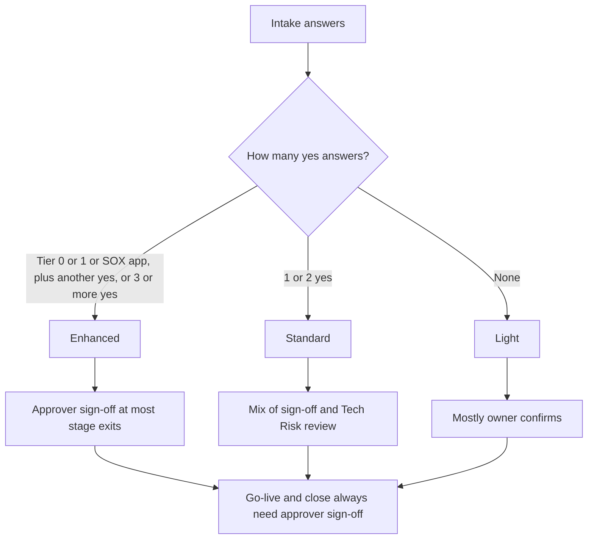

Every initiative gets an oversight level of Enhanced, Standard or Light when Tech Risk accepts it. The level sets what is needed to move from one stage to the next.

The stages, exit gates and evidence are in the [Initiative lifecycle](/guides/initiative-lifecycle/) guide.

## How the level is set

The owner answers these questions at intake. The level comes from the answers. Tech Risk confirms it, or changes it and records why, and checks it again at each stage exit.

- Is a BCP tier 0 or tier 1 app affected?
- Is a SOX in-scope app affected?
- Are key controls new, retired or redesigned?
- Is financial or regulated data migrated?
- Does it change how access is set up or reviewed?
- Does it move to a vendor or cloud platform?

## Which level

- Enhanced: a BCP tier 0 or tier 1 app or a SOX in-scope app is affected and at least one other answer is yes, or three or more answers are yes.
- Standard: one or two answers are yes.
- Light: no answers are yes.

## What is needed to move on

| Stage exit | Enhanced | Standard | Light |
|---|---|---|---|
| 1 Mobilize and design | Approver sign-off | Approver sign-off | Tech Risk review |
| 2 Build and configure | Approver sign-off | Tech Risk review | Owner confirms |
| 3 Test and validate | Approver sign-off | Tech Risk review | Owner confirms |
| 4 Cutover and go-live | Approver sign-off | Approver sign-off | Approver sign-off |
| 5 Hypercare and stabilize | Approver sign-off | Tech Risk review | Owner confirms |
| 6 Close | Approver sign-off | Approver sign-off | Approver sign-off |

Go-live and close always need approver sign-off.

## What each requirement means

- **Approver sign-off:** The program submits evidence for each checklist item, Tech Risk accepts it, and a named approver's decision is recorded: proceed, proceed with conditions, or hold.
- **Tech Risk review:** The program submits evidence and Tech Risk accepts it. No sign-off decision is needed.
- **Owner confirms:** The owner confirms each item is done.

A checklist item that doesn't apply is marked N/A, with the reason.

If you're unsure, Tech Risk can help.
